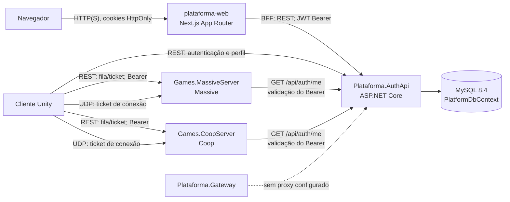
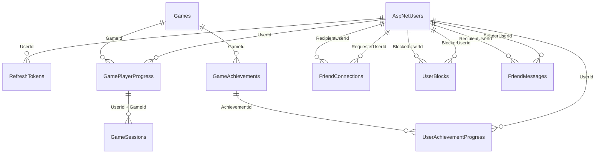
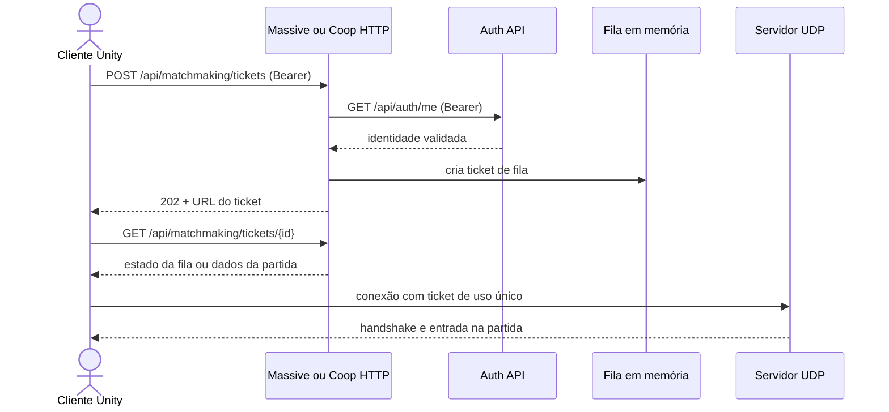

# Plataforma de jogos — arquitetura técnica

> Referência de arquitetura *as built*: descreve a estrutura presente no repositório, os contratos HTTP conhecidos e o modelo persistido. Itens explicitamente marcados como lacuna ou proposta não estão implementados.

**Revisão:** 17 de novembro de 2026 | **Versão:** 0.2 | **Repositório:** `MinhaPlataforma.Games`

## 1. Escopo e convenções

Este documento é voltado à implementação e à manutenção da plataforma: componentes, dependências, persistência, rotas e fluxos. Não é uma especificação comercial nem descreve a plataforma como produto pronto para venda.

| Marcador | Significado |
|---|---|
| **Implementado** | Existe no código deste repositório. |
| **Parcial** | Existe uma base técnica, mas não cobre o fluxo completo. |
| **Não implementado** | Não há código ou contrato correspondente nesta versão. |

As rotas abaixo são extraídas dos mapeamentos ASP.NET Core e dos Route Handlers do Next.js. `{id:guid}` representa um parâmetro GUID. Salvo indicação contrária, as APIs não têm versionamento explícito de URL.

## 2. Contexto e topologia

### 2.1 Componentes e dependências



O diagrama mostra os papéis implementados, não uma topologia de produção: no Compose as APIs HTTP e o MySQL são publicados em loopback; UDP também é local por padrão. O transporte UDP do jogo não é HTTPS e é independente do gateway HTTP.

### 2.2 Projetos e responsabilidades

| Projeto | Responsabilidade e estado |
|---|---|
| `Plataforma.Core` | Contratos e tipos compartilhados entre projetos .NET. |
| `Plataforma.Database` | `PlatformDbContext`, entidades, configuração de Identity e migrations do MySQL. |
| `Plataforma.AuthApi` | Minimal APIs para identidade, perfil, relações sociais, histórico de chat e hub SignalR. É a única API deste conjunto conectada diretamente ao banco. |
| `Plataforma.Gateway` | Aplicação separada que atualmente mapeia somente `GET /health`; não configura YARP, não faz proxy e não é iniciado pelo Compose. |
| `Games.MassiveServer` | Host HTTP + UDP e implementação compartilhada de fila, tickets e transporte. Perfil Massive: até 50 jogadores por partida. |
| `Games.CoopServer` | Executável separado que reutiliza o host/serviços de `Games.MassiveServer` com perfil Coop: até 4 jogadores. |
| `web/plataforma-web` | Next.js App Router, React e TypeScript. Páginas e Route Handlers BFF para Auth API e matchmaking Massive. |
| `tests/Games.MassiveServer.Tests` | Projeto de testes identificado para o servidor Massive. |

**Stack declarada nos projetos:** .NET 10 / ASP.NET Core, EF Core e `MySql.EntityFrameworkCore` 10.0.12; MySQL 8.4 no Compose; Next.js 16.4.6, React 19.3.0 e TypeScript no portal. As versões do portal vêm de `package.json`.

### 2.3 Composição local

O `docker-compose.yml` executa `mysql`, `migrations`, `auth-api`, `massive-server`, `coop-server` e `web`. A tarefa `migrations` aplica o schema antes da inicialização da Auth API. Portas padrão publicadas no host:

| Serviço | Porta HTTP | Porta UDP |
|---|---:|---:|
| MySQL | `127.0.0.1:3306` (configurável) | — |
| Auth API | `127.0.0.1:5000` | — |
| Massive | `127.0.0.1:5001` | `127.0.0.1:9050` |
| Coop | `127.0.0.1:5002` | `127.0.0.1:9051` |
| Portal | `127.0.0.1:3000` | — |

O Gateway não aparece na composição. Endereços, limites de jogadores, tempos de fila/ticket e chaves JWT são configurados pelo Compose/ambiente; ver [docker-compose.yml](../../docker-compose.yml) e [README.md](../../README.md).

## 3. Persistência e modelo relacional

### 3.1 Diagrama do schema da aplicação

O Identity também cria suas tabelas padrão (`AspNetUsers`, `AspNetRoles`, claims, logins, tokens e relações user-role). `ApplicationUser` estende `AspNetUsers` com `PlayerName` e `NormalizedPlayerName`. O diagrama abaixo destaca as entidades adicionais e suas chaves/relacionamentos:



`FriendConnections` representa um pedido pendente ou uma amizade aceita. `LowerUserId` e `UpperUserId` guardam o par ordenado e têm índice único para impedir duplicação em sentidos opostos; `RequesterUserId` e `RecipientUserId` preservam quem iniciou e quem recebeu o pedido.

### 3.2 Entidades, chaves e regras relevantes

| Tabela / entidade | Estrutura e restrições principais |
|---|---|
| Identity `AspNetUsers` / `ApplicationUser` | Identificador `Guid`; e-mail normalizado único; nome de jogador e nome normalizado com até 24 caracteres; nome normalizado único. |
| `RefreshTokens` | `Id` como PK; `UserId` FK para usuário; hash SHA-256 único; `FamilyId`, expiração, revogação e hash substituto. `ConcurrencyStamp` é token de concorrência. |
| `Games` | `Id` como PK; `Slug` único; nome obrigatório (120), descrição opcional (2000), ícone opcional (2048); estado `Draft`, `Published` ou `Archived`; índice `(Status, Name)`. |
| `GamePlayerProgress` | PK composta `(UserId, GameId)`; FKs para usuário e jogo; nível, experiência, partidas e tempo jogado; índice `(GameId, Experience)`. |
| `GameSessions` | `Id` como PK; referência composta `(UserId, GameId)` para o progresso; início/fim, pontuação, resultado e experiência concedida; índices por usuário/jogo/data e por jogo/data. A sessão, portanto, requer registro de progresso existente. |
| `GameAchievements` | `Id` como PK; FK de jogo; `Code` único por jogo; nome, descrição, pontos, alvo, critérios JSON e estado `Active`/`Archived`; índice `(GameId, Status)`. |
| `UserAchievementProgress` | PK composta `(UserId, AchievementId)`; progresso atual e data de conclusão opcional; FKs para usuário e conquista. |
| `FriendConnections` | `Id` como PK; FKs para solicitante e destinatário; status `Pending`/`Accepted`; par normalizado único; índices por destinatário/status/data e solicitante/status/data. |
| `UserBlocks` | PK composta `(BlockerUserId, BlockedUserId)`; bloqueio unidirecional; índice pelo usuário bloqueado. |
| `FriendMessages` | `Id` como PK; FKs de remetente e destinatário; conteúdo obrigatório de até 2000 caracteres; índices de histórico nos dois sentidos da conversa por data. |

**Não existem neste schema:** organizações/estúdios, membros e papéis de publicação, pedidos/pagamentos, entitlements/licenças, builds/releases, inventário ou ledger de moedas.

### 3.3 Migrations

As migrations versionadas estão em `src/Plataforma.Database/Migrations`. A sequência cobre schema inicial do Identity e refresh tokens, unicidade de e-mail, catálogo/progressão/conquistas, amizades/bloqueios e mensagens do chat. O snapshot EF Core é `PlatformDbContextModelSnapshot.cs`; alterações de schema devem ser feitas no modelo e em migration, não diretamente em banco compartilhado.

## 4. Árvore de rotas

### 4.1 Auth API — `Plataforma.AuthApi`

```text
GET    /health
GET    /openapi/v1.json                         [somente Development]
│
├── /api/auth
│   ├── POST /register                          [público]
│   ├── POST /login                             [público]
│   ├── POST /refresh                           [público; exige refresh token no corpo]
│   ├── POST /logout                            [público; revoga família de refresh token]
│   └── GET  /me                                [JWT Bearer]
│
├── /api/profile                                [JWT Bearer]
│   ├── GET  /
│   └── PUT  /player-name
│
├── /api/friends                                [JWT Bearer]
│   ├── GET    /
│   ├── GET    /search?q=...
│   ├── GET    /requests/incoming
│   ├── GET    /requests/outgoing
│   ├── POST   /requests
│   ├── GET    /requests/{requestId:guid}
│   ├── POST   /requests/{requestId:guid}/accept
│   ├── POST   /requests/{requestId:guid}/decline
│   ├── DELETE /requests/{requestId:guid}
│   ├── DELETE /{friendUserId:guid}
│   ├── GET    /blocks
│   ├── PUT    /blocks/{targetUserId:guid}
│   └── DELETE /blocks/{targetUserId:guid}
│
└── /api/chat                                   [JWT Bearer]
    ├── GET  /conversations/{friendUserId:guid}/messages?page=1&pageSize=50
    └── Hub /hub
        ├── JoinConversation(friendUserId)
        ├── LeaveConversation(friendUserId)
        └── SendMessage(friendUserId, content)
            evento servidor → cliente: MessageReceived
```

O histórico aceita `page` entre 1 e 10.000 e `pageSize` entre 1 e 100. As operações do hub e o histórico verificam a relação de amizade. Registro/login usam senha com comprimento mínimo de 12; a API configura bloqueio após cinco tentativas inválidas. O OpenAPI só é mapeado no ambiente `Development`.

### 4.2 Matchmaking — APIs HTTP dos servidores de jogo

Cada processo Massive/Coop expõe o mesmo conjunto de rotas HTTP e mantém estado independente:

```text
GET    /health
GET    /openapi/v1.json                         [somente Development]
│
└── /api/matchmaking/tickets
    ├── POST   /                                [Bearer da plataforma; entra na fila]
    ├── GET    /{ticketId:guid}                 [Bearer; consulta ticket do próprio usuário]
    └── DELETE /{ticketId:guid}                 [Bearer; cancela ticket]
```

O token é validado pela chamada server-to-server do processo de jogo para `GET /api/auth/me`; os servidores de jogo não recebem a chave de assinatura JWT. O estado da fila e os tickets são mantidos em memória. O canal de jogo é UDP separado das rotas HTTP e usa ticket de conexão curto e de uso único.

| Processo | Perfil padrão | Capacidade padrão | Portas locais |
|---|---|---:|---|
| `Games.MassiveServer` | Massive | 1–50 jogadores | HTTP 5001, UDP 9050 |
| `Games.CoopServer` | Coop | 1–4 jogadores | HTTP 5002, UDP 9051 |

### 4.3 Gateway — `Plataforma.Gateway`

```text
GET /health
```

O projeto não encaminha rotas para Auth API ou servidores de jogo: ainda não há configuração YARP, e o Gateway não é um serviço do Compose atual.

### 4.4 BFF web — Route Handlers Next.js

Estas rotas pertencem ao portal e não são endpoints da Auth API:

```text
GET  /api/health
│
├── /api/auth
│   ├── POST /register
│   ├── POST /login
│   ├── GET  /me
│   └── POST /logout
│
├── /api/platform/[...path]
│   └── GET | POST | PUT | DELETE
│       proxy para a Auth API, com JWT derivado de cookies HttpOnly
│
└── /api/matchmaking/massive/tickets
    ├── POST   /
    ├── GET    /{ticketId}
    └── DELETE /{ticketId}
```

O proxy `/api/platform/[...path]` encaminha os segmentos e a query string recebidos para a Auth API, renova a sessão quando necessário e protege mutações com verificação de mesma origem. O Route Handler de matchmaking presente no portal é para Massive; não foi encontrado Route Handler equivalente para Coop. O hub SignalR da Auth API é `/api/chat/hub`; a aplicação web usa o proxy/BFF para manter os tokens fora do JavaScript.

## 5. Fluxos técnicos principais

### 5.1 Sessão web

```mermaid
sequenceDiagram
    actor Browser as Navegador
    participant BFF as Next.js BFF
    participant API as Auth API
    participant DB as MySQL

    Browser->>BFF: POST /api/auth/login
    BFF->>API: POST /api/auth/login
    API->>DB: valida usuário e senha
    API-->>BFF: access token + refresh token
    BFF-->>Browser: cookies HttpOnly
    Browser->>BFF: GET /api/platform/profile
    BFF->>BFF: lê cookie; renova se necessário
    BFF->>API: GET /api/profile com Bearer
    API-->>BFF: perfil
    BFF-->>Browser: resposta sem expor token
```

Os refresh tokens persistidos são guardados como hash e rotacionados; reutilização pode revogar a família. O logout revoga refresh tokens, mas não invalida antecipadamente um access token JWT já emitido.

### 5.2 Matchmaking e ingresso UDP



O transporte atual retransmite snapshots de estado visual; não representa simulação autoritativa completa. Fila e estado da partida são locais ao processo, sem coordenação distribuída ou alocação automática de instâncias.

## 6. Configuração e execução

| Configuração | Uso |
|---|---|
| `ConnectionStrings:Platform` | Conexão MySQL da Auth API e do contexto EF. |
| `Jwt:Issuer`, `Jwt:Audience`, `Jwt:SigningKeyBase64` | Validação/emissão de JWT; chave Base64 com pelo menos 32 bytes. |
| `GameAuth:BaseUrl` | URL interna da Auth API chamada pelo servidor de jogo para validar tokens. |
| `GameServer:UdpPort`, `GameServer:PublicAddress` | Bind/anúncio do transporte UDP. |
| `Matchmaking:*` | Código do modo, limites de jogadores, janela de agrupamento, timeout de fila e duração do ticket. |
| `AUTH_API_BASE_URL` | URL da Auth API chamada no servidor Next.js. |
| `MASSIVE_API_BASE_URL` | URL da API Massive chamada no servidor Next.js. |

As seções .NET também podem ser definidas por variáveis de ambiente com `__` no lugar de `:` (ex.: `Jwt__Issuer`). Segredos devem ser fornecidos pelo ambiente ou gestor de segredos, nunca versionados.

Para executar migrations manualmente, use `dotnet ef database update` com `Plataforma.Database` como projeto e `Plataforma.AuthApi` como startup project, conforme os comandos do [README.md](../../README.md). O `docker-compose.yml` já executa uma etapa própria de migrations.

## 7. Limites e próximos pontos técnicos

Os itens abaixo são lacunas observadas, não funcionalidades existentes:

- Não há API administrativa para criar/editar/publicar `Games`, conquistas ou receber resultados confiáveis de partidas. As tabelas de catálogo e progressão estão preparadas no schema.
- Não há entidades nem rotas para estúdios, releases/builds, pedidos, pagamentos, licenças/entitlements, inventário ou economia.
- O Gateway não é proxy e não está integrado à composição local.
- A fila e os tickets são voláteis e de instância única; não há escala horizontal, scheduler de instâncias ou armazenamento compartilhado.
- O UDP do jogo ainda não tem proteção criptográfica de aplicação. Não o exponha publicamente sem um desenho e validação de confidencialidade, integridade e proteção contra replay.
- Não há confirmação de e-mail nem recuperação de senha nesta versão.
- O portal contém telas demonstrativas de loja/jogo; não são fluxo de compra, cobrança, entitlement ou distribuição de builds.

## 8. Código-fonte relacionado

- [Program.cs da Auth API](../../src/Plataforma.AuthApi/Program.cs) e [endpoints](../../src/Plataforma.AuthApi/Endpoints/)
- [FriendChatHub.cs](../../src/Plataforma.AuthApi/Hubs/FriendChatHub.cs)
- [PlatformDbContext.cs](../../src/Plataforma.Database/PlatformDbContext.cs), [entidades](../../src/Plataforma.Database/Entities/) e [migrations](../../src/Plataforma.Database/Migrations/)
- [GameServerHost.cs](../../src/Games.MassiveServer/Hosting/GameServerHost.cs), [rotas de matchmaking](../../src/Games.MassiveServer/Endpoints/MatchmakingEndpoints.cs) e [entry point Coop](../../src/Games.CoopServer/Program.cs)
- [Program.cs do Gateway](../../src/Plataforma.Gateway/Program.cs)
- [Route Handlers do portal](../../web/plataforma-web/src/app/api/) e [package.json](../../web/plataforma-web/package.json)
- [docker-compose.yml](../../docker-compose.yml)

Os diagramas Mermaid são fontes editáveis neste Markdown e refletem a implementação descrita acima; atualize-os junto com o código quando serviços, rotas ou relações de dados mudarem.
